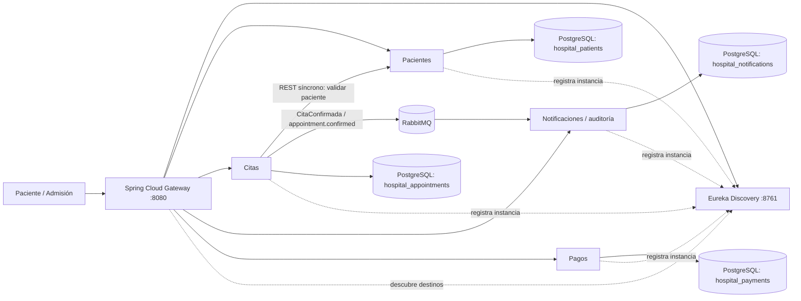

# Hospital Vida Salud

Proyecto académico de microservicios para procesos administrativos hospitalarios. Todos los datos de ejemplo son ficticios. No usar para decisiones ni atención clínica real.

## Alcance implementado

El flujo demostrable cubre el registro y consulta de pacientes, la programación y transición de citas, la validación síncrona paciente-cita, el evento asíncrono de confirmación, su registro como notificación/auditoría y el registro de pagos de prueba.

| Servicio | Responsabilidad y datos propios | Comunicación |
|---|---|---|
| `patient-service` | Pacientes; documento único y estado administrativo | REST reactivo + R2DBC |
| `appointment-service` | Agenda, citas y transiciones permitidas | REST reactivo + consulta síncrona a Pacientes + publicación RabbitMQ |
| `notification-service` | Consumo idempotente y persistencia del evento recibido | RabbitMQ + R2DBC; consulta reactiva de registros |
| `payment-service` | Pagos simulados, monto positivo y operación única | REST reactivo + R2DBC |
| `api-gateway` | Único punto de entrada HTTP; rutas `lb://` | Eureka/LoadBalancer |
| `discovery-server` | Registro y descubrimiento Eureka | Registro de Gateway y microservicios |

Laboratorio, atenciones, farmacia y hospitalización quedan fuera de este corte funcional: se prioriza un flujo de extremo a extremo comprobable sin inventar procesos clínicos. La arquitectura los incorporaría como servicios dueños de sus propios datos, usando referencias por identificador. No se guardan historias clínicas ni resultados clínicos.

## Arquitectura y flujo



Cada servicio tiene una base de datos PostgreSQL independiente (un único servidor Docker para el laboratorio). No hay claves foráneas entre servicios; `patientId` y otros identificadores son referencias de contrato. La cita valida la existencia del paciente mediante HTTP y responde `422` si no existe, o `503` si Pacientes no está disponible; la llamada síncrona tiene un timeout de respuesta de 3 segundos. La confirmación guarda primero el estado y luego publica el evento; para una solución productiva se recomienda patrón Outbox y reintentos.

`appointment.confirmed` se publica en el exchange topic durable `hospital.events`; la cola durable `notifications.appointment-confirmed` la consume Notificaciones y Auditoría. El evento registra estados anterior/nuevo y origen; el consumidor persiste el `eventId` como clave primaria para que una redelivery no duplique registros. El listener RabbitMQ usa su hilo de consumo dedicado; los controladores y los accesos R2DBC exponen `Mono`/`Flux` sin JDBC ni bloqueos en el pipeline HTTP.

## Requisitos

- Docker Desktop con Docker Compose v2 iniciado.
- Para compilar en GitHub Actions: JDK 17 (Temurin) y Maven 3.9+.
- Postman es opcional; se incluye una colección importable en `postman/Hospital Vida Salud.postman_collection.json`.

Este equipo de desarrollo tiene Java 8 y no tiene Maven instalado; Spring Boot 3 requiere Java 17. Por ello la compilación local se ejecuta dentro de Docker o en GitHub Actions, no con el Java 8 instalado en Windows.

## Ejecución con Docker Desktop

Abre PowerShell en la carpeta del proyecto. Crea tu configuración local (el archivo `.env` está excluido de Git) y reemplaza los valores de ejemplo por contraseñas locales propias:

```powershell
Copy-Item .env.example .env
# Edita .env y cambia POSTGRES_PASSWORD y RABBITMQ_PASSWORD
docker compose up -d
docker compose ps
```

La primera ejecución compila y prueba el reactor Maven en un contenedor Java 17, guarda los seis JAR en un volumen Docker y luego inicia los servicios; puede demorar mientras descarga dependencias e imágenes. Maven y Java 17 no necesitan estar instalados en Windows. URLs:

Si cambias las variables en `.env` después de iniciar los contenedores, aplícalas con `docker compose up -d --force-recreate`.

- API: `http://localhost:8080`
- Panel Eureka: `http://localhost:8761`
- RabbitMQ Management: `http://localhost:15672` (usuario `hospital` y la clave que configuraste en `.env`)
- Estado Gateway: `http://localhost:8080/actuator/health`

En Eureka deben aparecer `API-GATEWAY`, `PATIENT-SERVICE`, `APPOINTMENT-SERVICE`, `NOTIFICATION-SERVICE` y `PAYMENT-SERVICE`. Los clientes solo usan el Gateway; no deben fijar los puertos internos (8081–8084).

Para detener los servicios sin borrar datos:

```powershell
docker compose down
```

Para reiniciar desde cero y borrar las bases de datos locales de prueba, ejecuta `docker compose down -v` (elimina el volumen `postgres-data`).

## Pruebas automatizadas

Con JDK 17 y Maven instalado:

```powershell
mvn --batch-mode verify
```

También es posible probar sin instalar Maven en el host, con Docker Desktop iniciado:

```powershell
docker run --rm -v "${PWD}:/workspace" -w /workspace maven:3.9.9-eclipse-temurin-17 mvn --batch-mode verify
```

Las pruebas unitarias validan registro correcto y duplicidad de paciente, recurso inexistente, transiciones de cita, rechazo de pagos con monto cero y persistencia/idempotencia del consumidor de eventos RabbitMQ. CI ejecuta `mvn --batch-mode --no-transfer-progress verify` en todos los módulos ante cada `push` y `pull_request` a `main` o `master`; cualquier error hace fallar el job.

## Prueba funcional con Postman o curl

La colección Postman incluida crea un paciente ficticio, intenta duplicarlo, crea una cita futura, la confirma y consulta los eventos recibidos. También comprueba el rechazo de pago con monto cero. Importa la colección, ejecuta las peticiones en orden y revisa las pruebas (Tests) de cada respuesta.

Ejemplo manual en PowerShell:

1. Registrar paciente:

```powershell
$testDocument = "TEST-$([guid]::NewGuid().ToString('N').Substring(0, 12))"
$patientBody = @{ documentType = 'DNI'; documentNumber = $testDocument; firstNames = 'Ana'; lastNames = 'Prueba'; birthDate = '1995-03-10'; phone = '900000001'; email = 'ana@example.test'; address = 'Direccion ficticia' } | ConvertTo-Json
$patient = Invoke-RestMethod -Method Post -Uri http://localhost:8080/api/patients -ContentType 'application/json' -Body $patientBody
$patient.id
```

2. Registrar cita (fecha local futura) y conservar el código que devuelve:

```powershell
$appointmentBody = @{ patientId = $patient.id; specialty = 'Medicina general'; appointmentAt = (Get-Date).AddDays(2).ToString('yyyy-MM-ddTHH:mm:ss'); professionalCode = 'PROF-TEST-01'; administrativeReason = 'Control administrativo de prueba' } | ConvertTo-Json
$appointment = Invoke-RestMethod -Method Post -Uri http://localhost:8080/api/appointments -ContentType 'application/json' -Body $appointmentBody
```

3. Confirmar y revisar el evento consumido:

```powershell
Invoke-RestMethod -Method Patch -Uri "http://localhost:8080/api/appointments/$($appointment.id)/status" -ContentType 'application/json' -Body '{"status":"CONFIRMED"}'
Start-Sleep -Seconds 2
Invoke-RestMethod -Uri http://localhost:8080/api/notifications
```

El segundo intento de registro del mismo documento debe responder `409 Conflict`; un paciente inexistente al reservar devuelve `422`; transición no permitida devuelve `409`; un monto cero o negativo para pago devuelve `400 Bad Request`.

## Endpoints principales

| Método | Ruta (a través de Gateway) | Resultado |
|---|---|---|
| `POST` | `/api/patients` | Registra paciente; `201`, duplicado `409` |
| `GET` | `/api/patients/{id}` | Consulta por UUID; inexistente `404` |
| `PUT` | `/api/patients/{id}` | Actualiza datos; mantiene fecha de registro y estado |
| `GET` | `/api/patients` | Lista pacientes |
| `POST` | `/api/appointments` | Valida paciente, agenda y crea en `PENDING` |
| `GET` | `/api/appointments/{id}` | Consulta cita |
| `GET` | `/api/appointments` | Lista citas |
| `PATCH` | `/api/appointments/{id}/schedule` | Reprograma cita activa a fecha futura; vuelve a `PENDING` |
| `PATCH` | `/api/appointments/{id}/status` | `CONFIRMED`, `CANCELLED`, `ATTENDED` o `ABSENT`, según transición |
| `GET` | `/api/notifications` | Lista eventos confirmados consumidos |
| `POST` | `/api/payments` | Registra pago positivo y operación irrepetible |
| `GET` | `/api/payments/{id}` | Consulta pago |
| `GET` | `/api/payments` | Lista pagos |

Transiciones de citas: `PENDING -> CONFIRMED | CANCELLED`; `CONFIRMED -> ATTENDED | CANCELLED | ABSENT`. Estados terminales no admiten más cambios. No se permite reservar el mismo profesional en el mismo horario si ya existe una cita `PENDING` o `CONFIRMED`. Todas las fechas de cita deben ser futuras.

## Datos, validaciones y privacidad

- Los datos se separan en cuatro bases propias: pacientes, citas, notificaciones y pagos. Restricciones e índices SQL protegen documento único, referencias de agenda, operación de pago y monto positivo. El campo de versión de Spring Data R2DBC distingue inserciones con UUID asignado de actualizaciones y permite control optimista de cambios.
- R2DBC PostgreSQL + `ReactiveCrudRepository` para lecturas y escrituras. `Mono` representa una entidad/resultado y `Flux` una lista reactiva.
- Todo documento/dato usado en pruebas es ficticio. El email `.test` es reservado para pruebas.
- Las contraseñas se leen desde variables de entorno; `docker-compose.yml` no contiene claves por defecto. Mantén `.env` local, reemplaza los marcadores antes de iniciar Docker y nunca subas `.env` ni secretos. `.env.example` es solo una plantilla.

## GitHub y CI

1. Crea un repositorio vacío en GitHub y, si no tienes Git, instala Git for Windows.
2. Desde esta carpeta, configura y publica el repositorio:

```powershell
git init
git add .
git commit -m "feat: implementar microservicios Hospital Vida Salud"
git branch -M main
git remote add origin https://github.com/USUARIO/REPOSITORIO.git
git push -u origin main
```

Reemplaza `USUARIO/REPOSITORIO` por el remoto creado. El workflow `.github/workflows/ci.yml` compila y prueba todos los módulos con Java 17, sin secretos ni despliegue automático.

Para demostrar un fallo controlado sin dejar código defectuoso en `main`, crea una rama temporal, provoca allí una aserción fallida, súbela y comprueba que Actions queda rojo; luego revierte solo ese cambio en la rama, vuelve a subir y captura la ejecución verde. No se deben presentar capturas fabricadas: guarda capturas reales de Actions, Eureka, RabbitMQ y las respuestas Postman cuando ejecutes la demo. Git/GitHub y la cuenta remota deben configurarse en tu equipo; no se han creado repositorio, commits ni evidencias remotas desde este proyecto.

## Sustentación breve

- **Límites:** Pacientes es dueño del documento y datos de contacto; Citas es dueño de agenda y estado; Pagos es dueño de operaciones simuladas; Notificaciones/Auditoría conserva los eventos recibidos.
- **Síncrono:** Citas consulta Pacientes para validar el identificador antes de guardar; se usa respuesta inmediata y timeout/error de red genera indisponibilidad explícita.
- **Asíncrono:** confirmar una cita publica `AppointmentConfirmed`; RabbitMQ desacopla Citas de notificación/auditoría, que persiste el evento y puede evolucionar de forma independiente.
- **Gateway/Eureka:** Gateway expone una dirección estable al consumidor y usa nombres lógicos registrados en Eureka/LoadBalancer para resolver instancias.
- **Reactividad:** las API y persistencia del camino HTTP utilizan WebFlux, `Mono`/`Flux` y R2DBC. Esto evita reservar un hilo por cada I/O y permite manejar concurrencia; el consumidor Rabbit usa su hilo dedicado, separado de las peticiones HTTP.
- **CI:** cada cambio hacia ramas principales compila y ejecuta las pruebas; un job rojo impide considerar validado el cambio hasta corregirlo.
